# Volt Library Registry — System Architecture

A secure, curated distribution system for Volt device libraries: authors create and
submit libraries on the web, a review pipeline vets them, the registry **signs** the
approved artifact, and the **Volt IDE** verifies and imports only signed, sandboxed
packages. The IDE never creates libraries and never trusts unsigned foreign code.

---

## 1. Goals & non-goals

| Goal | How |
|---|---|
| No unsigned foreign code ever compiled/flashed | Signed `.vlib` only; hardened import |
| A review miss is *contained*, not catastrophic | Sandboxed import (paths/allowlist/caps) + curation |
| Poisoned **updates** can't sneak in | Per-version review, version+hash pinning, no auto-update |
| Grow the ecosystem | Browse/install/publish are **free**; monetize AI/Pro only |
| Match how we already build | Mirror the `lovelane` Go + Next.js + Dokploy stack |

**Non-goals:** library creation in the IDE (web-only); DRM/encryption of source
(we sign for *authenticity*, not confidentiality); charging for the ecosystem.

---

## 2. Security model in one line

> **Curation** (you review) **+ Signing** (provenance) **+ Hardened import** (containment).
> Signing proves *who*; review proves *vetted*; the sandbox ensures a review miss can't
> escape `devices/`. Same trust model as an app store.

Encryption is *not* the security primitive here — a signed-but-malicious lib is still
malicious, and an encrypted one is no safer. **Sign, don't (just) encrypt.**

---

## 3. System context

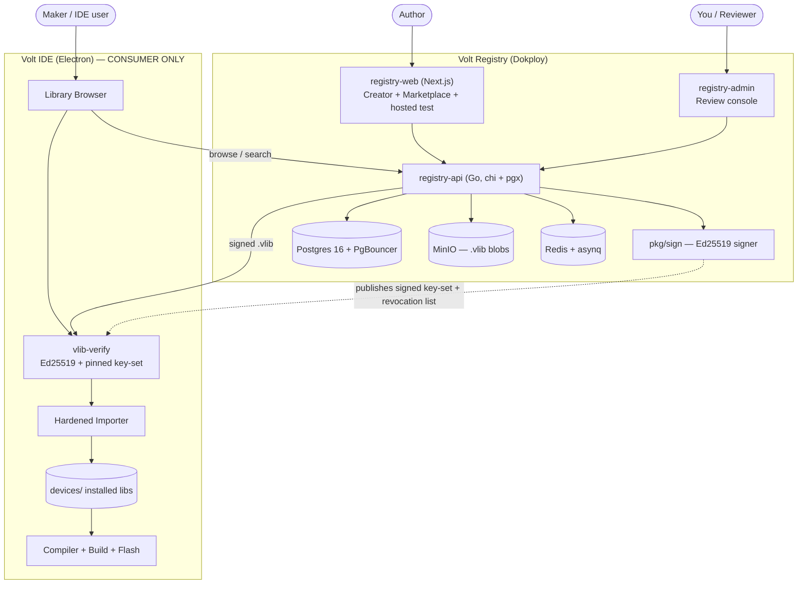

---

## 4. The `.vlib` package format

A **single signed JSON envelope** — *not* an archive (no zip-slip, symlink, or
path-traversal surface at extraction time; you parse fields, you never "extract").

```jsonc
{
  "schema": 1,
  "manifest": {
    "name": "BMP280", "prefix": "bmp280", "version": "1.2.0",
    "interface": "i2c", "capabilities": ["i2c"],
    "author": "gh:alice", "publishedAt": "2026-07-11T…Z",
    "minVoltVersion": "2.1.0", "trustTier": "verified"
  },
  "device": { /* device.json — strict-schema validated */ },
  "driver": { "common": "<C source>", "esp32": "<C?>", "rp2040": "<C?>" },
  "header": { "fields": [ … ], "methods": [ … ] },   // STRUCTURED, not raw C
  "hash":      "sha256:…",     // over canonical(manifest+device+driver+header)
  "signature": "ed25519:…"     // over hash, by the registry key
}
```

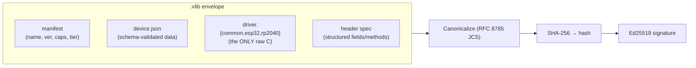

**Key decision:** the only raw code is `driver.c` (unavoidable — it compiles for the
MCU, contained). Everything else is *data*: `device.json` is schema-validated, and the
`<prefix>_t` struct + prototypes are a **structured spec the IDE re-emits itself** — so
raw code can never be injected into a shared header or the build system.

---

## 5. Cryptography — signing & verification

- **Algorithm:** Ed25519 (fast, tiny signatures; Node's built-in `crypto` and Go's
  `crypto/ed25519` — zero extra deps in the IDE).
- **Canonicalization:** RFC 8785 **JCS** on both sides, so the bytes hashed in Go equal
  the bytes hashed in Node. *This is the highest-risk interop detail in the system.*
- **Pinned key-set (rotatable):** the IDE ships a **signed key-set**, not one hardcoded
  key. An old key signs the new key-set → rotate/add keys without shipping a new IDE.
- **Verification is offline** (works air-gapped); an **optional online revocation check**
  (signed, cached) kills a compromised version.

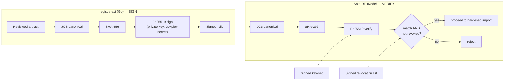

---

## 6. Author flow — create → submit → review → sign → publish

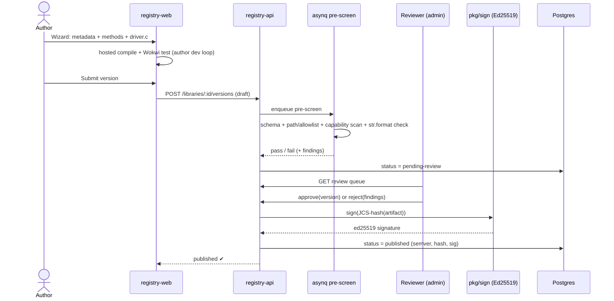

Automated pre-screen (a hard gate before human eyes):

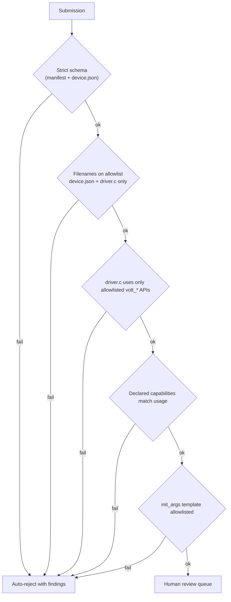

---

## 7. Consumer flow — browse → install → verify → import

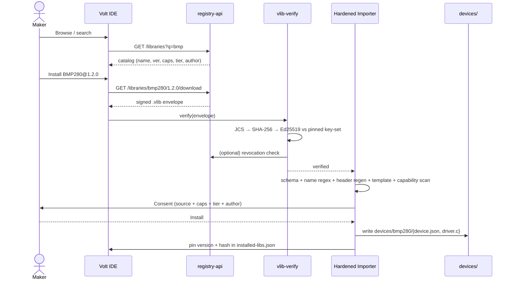

---

## 8. The hardened importer (IDE secure core)

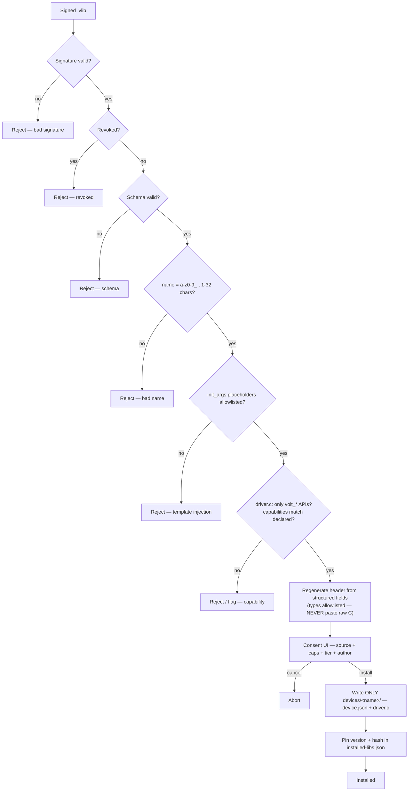

Defenses embodied here: **path allowlist** (no traversal, no writing outside
`devices/<name>/`), **no build hooks** (only `.json` + `.c` accepted → no host RCE),
**structured header regen**, **template allowlist** (kills the `str.format` hole),
**capability + static scan**, and **explicit consent**.

---

## 9. Trust tiers & capabilities

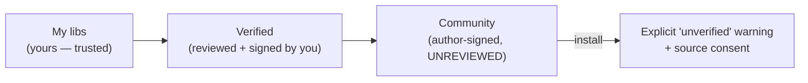

**Capabilities** (declared in the manifest, enforced by the static scan, shown on
consent): `i2c`, `spi`, `gpio`, `uart`, `network`, `storage`.
A distance sensor declaring `network` is an instant review flag.

---

## 10. Threat model

| Threat | Defense |
|---|---|
| Tampered / forged `.vlib` | Ed25519 signature + pinned, rotatable key-set |
| Zip-slip / path traversal | JSON envelope + `devices/<name>/` write allowlist |
| Build-time RCE on user's laptop | No build hooks; only `.json` + `.c` accepted |
| Codegen format-string exploit | `str.format` → explicit substitution + template allowlist |
| Malicious header/macro injection | Header regenerated from structured spec (never raw C) |
| Malicious C on the MCU | Capability declaration + static scan + **your review** + consent |
| **Poisoned update** (the real one) | Per-version review, version+hash pinning, no silent update |
| Typosquatting in "universe" libs | Curation gate + trust tiers + author identity |
| Compromised signing key | Key-set rotation + signed revocation list |
| Malicious registry response (MITM) | Client verifies signature offline regardless of transport |

Residual risk: a signed, sandboxed lib still runs C on the MCU. Contained by
provenance (signing) + your review (you vouch) + user consent — the app-store model.

---

## 11. Data model (registry DB)

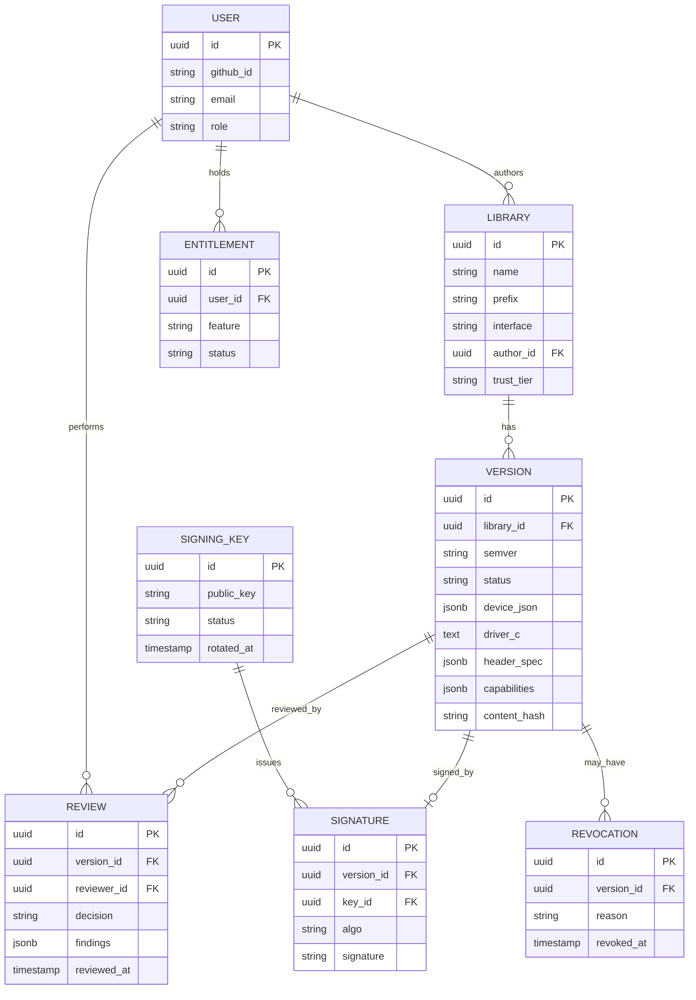

---

## 12. Tech stack (mirrors `lovelane`)

| Layer | Choice | Reuse from lovelane |
|---|---|---|
| API | Go, **chi** + **pgx** (no ORM), golang-migrate | `internal/domain/*`, `pkg/{apperror,response,validator,token,crypto}`, `middleware/`, `config` (caarlos0/env) |
| Auth | OAuth → JWT (HS256 access + hashed refresh + DB sessions) | `domain/auth`, `pkg/token` — add **GitHub** OAuth (dev audience) |
| DB | Postgres 16 + PgBouncer | `services/` compose |
| Jobs | asynq (Redis) for pre-screen | existing asynq wiring |
| Blobs | MinIO (or Postgres — `.vlib` are small) | `storage/minio` |
| **Signing** | **Ed25519 `pkg/sign`** — *new* | closest template: `pkg/apple/revoker.go` (PEM-from-env, sign) + `pkg/crypto/aes.go` (versioned envelope) |
| Web | Next.js App Router, Tailwind v4, shadcn/ui | `web/`, `admin/`, `store/` |
| Admin/review | next-auth + TOTP; `AdminSecret`-gated `/api/internal/admin` | `admin/` |
| Deploy | Dokploy + Traefik, per-service Dockerfile + compose | wholesale |
| **Tests/CI** | **required for sign/verify/import** | *gap in lovelane — improve here* |

---

## 13. Deployment (Dokploy + Traefik)

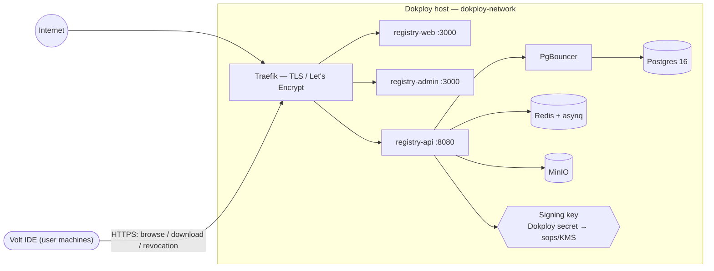

---

## 14. Responsibility split

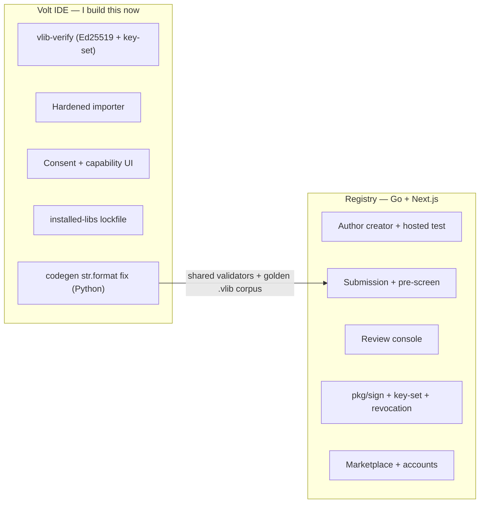

**Shared correctness contract:** the hardened-import validators run in **both** the Go
pre-screen and the JS importer. Bind them with a **JSON-Schema spec + a golden `.vlib`
test corpus** both must agree on — else the server signs something the IDE rejects, or
the IDE trusts something the server would have caught.

---

## 15. Prerequisite fix (do regardless)

`codegen.py` currently emits device inits via `template.format(**fmt_args)`. Python's
`str.format` is an **injection vector** (a template like `{pin.__class__…__globals__}`
can read interpreter internals at compile time). The moment third-party `device.json`
is imported, that's a live hole.

**Fix:** replace `str.format` with explicit substitution of a fixed placeholder set
(`{pin}`, `{addr}`, `{bus_id}`, `{trig}`, `{echo}`, …) and validate templates against
that allowlist on import. This lands in the IDE secure core.

---

## 16. Open decisions

1. Strip the IDE creator now, or park it until the Go generator exists (`device-creator.js` becomes the port reference)?
2. `.vlib` = single signed JSON envelope (recommended) vs archive?
3. Signing-key management: Dokploy env secret now → sops/KMS soon?
4. Capability starter set: `i2c / spi / gpio / uart / network / storage`?
5. Auth: GitHub + Google OAuth (GitHub-first)?

---

## 17. Build order

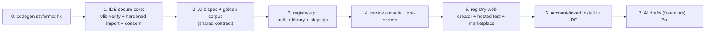

The IDE secure core (steps 0–1) is **decision-independent** — safe to build first while
the registry stack and open decisions are settled.
